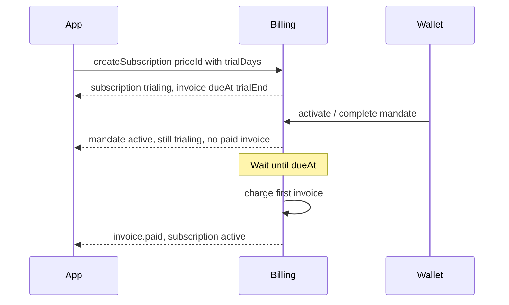

# Subscription trials

Connect the customer wallet (mandate) up front. Grant access during a free trial. **Charge the first USDC invoice after `trialDays`.** Cancel during the trial collects **$0**.

## Status

| Capability | Status |
|------------|--------|
| Catalog field `Price.trialDays` | Available in portal / API |
| Engine: `trialing` + delayed first `dueAt` | enterprise-proven (unit tests) |
| Hosted API passes `price.trialDays` into create | enterprise-proven (billing-hosting pin + production) |
| Hosted API matrix (create / activate mandate / charge-after-due / cancel-in-trial / trialDays=0) | enterprise-proven |
| Hosted **checkout UI** ($0 due today, mandate-only path, trial success) | enterprise-proven (test mode) |
| Live-mode on-chain first charge after trial | **not proven** |
| Multi-merchant isolation under trials | **not proven** |

Hosted test-mode checkout UI is proven ($0 due today, mandate-only activate, Trial started). Live-mode first charge after trial and multi-merchant isolation remain **not proven**.

## Product rules

1. Create a recurring price with `trialDays` (whole days, `0` = no trial).
2. `createSubscription` with that `priceId` (or sandbox `trialDays`) starts the subscription as **`trialing`**.
3. First open invoice exists with **`dueAt = trial end`**. It is not chargeable yet.
4. Checkout / activate completes the **mandate only** while the invoice is not due. Status stays `trialing`.
5. When `dueAt` arrives, the worker (or `chargeInvoice`) collects the first payment → status **`active`**, paid period starts.
6. Cancel while `trialing` (period-end) sets `cancelAtPeriodEnd`, **voids** the conversion invoice (no charge), and stays resumable until trial end. Immediate cancel still ends the trial now. The worker calls `finalizeCancelAtPeriodEnd` after `currentPeriodEnd`.
7. One-time / `interval: once` prices do not use trials.

## Sequence

## API surface

- **Catalog:** `POST /v1/products` nested `price.trialDays`, `POST /v1/products/:id/prices`, `PATCH /v1/prices/:id`
- **Subscribe:** `POST /v1/subscriptions` with `priceId` (hosted resolves trial from the price)
- **Sandbox SDK:** `createSubscription({ amountUsdc, interval, trialDays })`
- **Lifecycle:** see [Lifecycle](/guide/lifecycle) for the `trialing` state

## Webhooks your app should handle

| Event | Trial meaning |
|-------|----------------|
| `subscription.created` | Often `status: trialing` when `trialDays > 0` |
| `subscription.activated` | Mandate active; may still be `trialing` (no charge yet) |
| `invoice.paid` | First (or renewal) charge succeeded → treat as paid entitlement |
| `subscription.canceled` | Including cancel-in-trial; revoke access; expect no paid invoice |

Grant **trial access** when the mandate is active and status is `trialing`. Convert to a **paid period** on `invoice.paid`. Do not invent a host-only “fake trial” that still charges on activate.

## Enterprise proof

**Hosted test matrix (proven on billing.autlantic.com):**

1. Engine unit tests for create / mandate-without-charge / charge-after-due / cancel-in-trial
2. Published npm (`billing-engine@0.3.23`+) pinned on billing-hosting `production`
3. Hosted API E2E: `trialDays=7` → activate mandate $0 (stay `trialing`) → test clock past `dueAt` → charge → `active`; cancel-in-trial voids invoice; `trialDays=0` still incomplete→paid
4. Hosted checkout UI E2E (test mode): `Total due today` = `0.00 USDC`, consent `0.00 USDC today`, sandbox CTA **Start trial in test mode**, success **Trial started** / charged today `0.00 USDC`; `/status` returns `checkoutPhase: trial_active` + `trialStarted: true` with no paid invoice

**Still not proven:** live-mode on-chain trial conversion; multi-merchant isolation.

## Related

- [Lifecycle](/guide/lifecycle)
- [Sandbox](/guide/sandbox)
- [Webhooks](/guide/webhooks)
- [Changelog](/resources/changelog)
